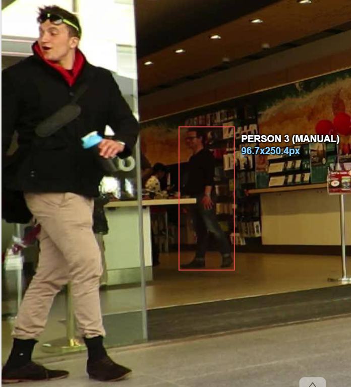
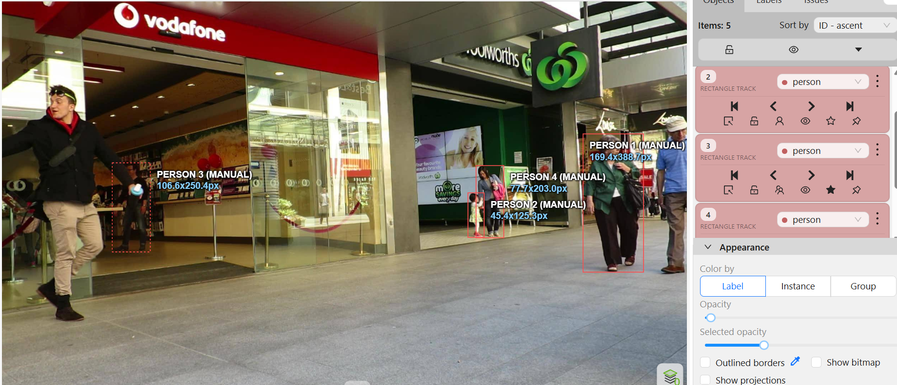
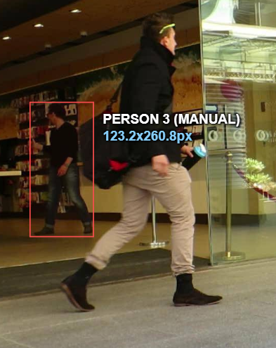

# Báo cáo cá nhân — TranTuanAnh-2A202603230

Đoạn video: MOT17-09, 150 frame (frame 1–150), nguồn MOTChallenge, giấy phép CC BY-NC-SA 3.0.

## 0. Thông tin học viên

- Họ tên: Trần Tuấn Anh
- MSSV: 2A202603230
- Mã đề (A/B/C): B (P1–P5 = ID MOT17 1, 19, 20, 21, 22)
- Email: 26ai.anhtt5@vinuni.edu.vn
- Link repository: https://github.com/plastma65/K5-L2-DAY05-TranTuanAnh-2A202603230-MOTTracking
- Giờ bắt đầu: 16:00
- Giờ kết thúc: 18:10 (lần cập nhật cuối của job trên CVAT)

Bảng đối chiếu mã người với track trong file xuất (dùng cho cả báo cáo):

| Mã | ID MOT17 (đề B) | Track trong CVAT (`annotations.xml`) | Track ID trong `gt.txt` |
|---|---:|---:|---:|
| P1 | 1 | 2 | 3 |
| P2 | 19 | 0 | 1 |
| P3 | 20 | 4 | 5 |
| P4 | 21 | 1 | 2 |
| P5 | 22 | 3 | 4 |

## 1. Xem trước đoạn video (CP0)

Ghi **trước khi vẽ**, mỗi người một dòng. Số frame theo CVAT (bắt đầu từ 0).

| Mã | Frame xuất hiện | Frame cuối thấy được | Rẽ / dừng / đổi tốc độ ở frame | Bị che ở frame | Ghi chú |
|---|---|---|---|---|---|
| P1 | 0 | 149 | đi chậm sang phải, tăng tốc sau khi hiện lại (~50–60) | 28–39 che một phần, 40–49 khuất hẳn, 50–54 che một phần | Người ở mép trái, bị người áo đen đi ngang che |
| P2 | 0 | 149 | đi sang trái, lại gần camera (~100–140) | không | Box lớn nhất, gần camera |
| P3 | 30 | 149 | đi vào từ mép phải khung hình | không | Xuất hiện muộn, box bị cắt ở mép phải lúc vào |
| P4 | 0 | 146 | đi chậm, gần như đứng sau ~110 | 106–111 che một phần, 112–136 khuất hẳn, 137–139 và 144–146 che một phần | Người nhỏ ở xa, đứng gần P5 |
| P5 | 0 | 105 | đi sang phải rồi ra khỏi tầm nhìn | 90–105 che một phần, từ 106 khuất hẳn | Đi sát P4 |

## 2. Keyframe và thời gian (CP1, CP4)

Số keyframe lấy từ kết quả `src/check_submission.py`.

| Mã | Số keyframe | Keyframe ở frame | Số frame có mặt | Keyframe / 100 frame | Thời gian (phút) | Chỗ khó |
|---|---|---|---|---|---|---|
| P1 | 19 | 0, 17, 20, 28, 30, 50, 53, 55, 57, 60, 70, 80, 90, 100, 110, 120, 130, 140, 149 | 140 | 13.6 | 10 | Bị che 28–54, khuất hẳn 40–49, box đổi kích thước khi hiện lại |
| P2 | 21 | 0, 10, 20, 30, 40, 50, 60, 70, 80, 90, 100, 109, 110, 119, 120, 129, 130, 137, 139, 140, 149 | 150 | 14.0 | 10 | Gần camera, box to, trôi nhanh ở đoạn 100–140 |
| P3 | 13 | 30, 40, 50, 60, 70, 80, 90, 100, 110, 120, 130, 140, 149 | 120 | 10.8 | 10 | Vào từ mép phải, box bị cắt ở mép ảnh |
| P4 | 13 | 0, 10, 20, 30, 40, 50, 80, 100, 106, 110, 137, 140, 144 | 122 | 10.7 | 15 | Người nhỏ, khuất 25 frame rồi hiện lại |
| P5 | 6 | 0, 10, 20, 30, 40, 90 | 106 | 5.7 | 10 | Bị P4/người khác che rồi ra khỏi khung |
| **Tổng** | **72** | | **638** | **11.3** | **55** | **P4 là chỗ khó nhất** |

Keyframe / 100 frame của cả bài = tổng keyframe ÷ tổng số frame có mặt × 100 = 72 ÷ 638 × 100 ≈ **11.3**.

Bạn đặt keyframe nhiều nhất ở người nào? Vì sao (người đó rẽ, dừng, lại gần camera hay bị che)?

Nhiều nhất ở **P2** (21 keyframe, 14.0 / 100 frame). P2 đứng gần camera nên box rất lớn (~160×350 px, cao dần lên ~410 px), chỉ cần di chuyển một chút là box nội suy lệch nhiều pixel. Đoạn 100–140 P2 lại gần camera hơn và đổi tốc độ, nên phải thêm keyframe dày (109/110, 119/120, 129/130, 137/139) để sửa box bị trôi. P1 đứng thứ hai (19 keyframe) vì đoạn bị che 28–54: keyframe ở 17 và 28 để đặt đúng mốc bật/tắt cờ `occluded`, và dồn ở 50, 53, 55, 57 để bắt lại box khi người hiện ra.

## 3. Đoạn bị che (CP2)

Người bị che: `P1` (ID MOT17 = 1, track CVAT 2)

| Mốc | Frame |
|---|---:|
| Bắt đầu bị che một phần (bật `occluded`) | 28 |
| Mất hẳn (bật `outside`) | 40 |
| Hiện lại (tắt `outside`) | 50 |
| Thấy rõ trở lại (tắt `occluded`) | 55 |

- Thời gian khuất hẳn: 10 frame (40–49) = khoảng 0.33 giây (MOT17-09 quay 30 fps).
- Quyết định: **giữ cùng ID**.
- Lý do:
  1. Khuất 10 frame, ngắn hơn nhiều so với ngưỡng 60 frame.
  2. Ngoại hình khớp: cùng dáng người, cùng màu quần áo trước và sau khi bị che.
  3. Chỗ hiện lại đúng hướng và tốc độ: trước khi khuất box ở x ≈ 310 (frame 30–40), hiện lại ở x ≈ 348 (frame 50), tức là tiếp tục đi sang phải với tốc độ gần như cũ.

Ngoài ra P4 cũng khuất hẳn 25 frame (112–136), dưới 60 frame, hiện lại gần đúng chỗ cũ (x ≈ 1315 → 1320) nên cũng giữ cùng ID.

Ảnh chụp màn hình:





## 4. Tự review ID (CP3)

Lượt 1 theo người (đi ngược từ frame 149 về 0 trên CVAT), lượt 2 theo cảnh (nhảy 10 frame). Ít nhất 3 dòng; không có lỗi thì ghi một dòng "đã kiểm hai lượt, không lỗi".

Loại lỗi dùng đúng một trong 7 mã: `id_switch`, `fragmentation`, `lost`, `merge`, `false_track`, `drift`, `flag`.

| Frame | Mã người | Loại lỗi | Mô tả một câu | Phát hiện ở lượt | Đã sửa? |
|---:|---|---|---|---|---|
| 0 | P1 | `flag` | Cờ `occluded` bị bật từ frame 0 dù P1 vẫn thấy rõ tới frame 27 (người áo đen chỉ bắt đầu che từ 28) | Kiểm lại theo người khi chụp ảnh mục 3 (sau lượt 1, 2) | Đã sửa 17–27; 0–16 còn bật, cần sửa nốt |
| — | P2–P5 | — | Đã kiểm hai lượt, không lỗi | 1 và 2 | — |

Tổng hợp số lỗi theo loại:

| `id_switch` | `fragmentation` | `lost` | `merge` | `false_track` | `drift` | `flag` |
|---:|---:|---:|---:|---:|---:|---:|
| 0 | 0 | 0 | 0 | 0 | 0 | 1 |

Lỗi nào chỉ lượt 2 (theo cảnh) mới thấy, lượt 1 (theo người) không thấy? Vì sao?

Không có lỗi nào chỉ lượt 2 mới thấy. Lỗi `flag` duy nhất của P1 cả hai lượt đều bỏ sót. Mình chỉ phát hiện khi chụp ảnh "trước khi che": P1 thấy rõ nhưng cờ vẫn bật. Lỗi cờ khó thấy khi tua nhanh, vì box nét đứt hay nét liền đều nằm đúng chỗ. Phải nhìn panel object ở từng frame mới thấy. Lượt 1 (theo từng người, đi ngược 149 → 0) kiểm tra box có bám đúng người và cờ `occluded` / `outside` có bật đúng đoạn che không. Lượt 2 (theo cảnh, nhảy 10 frame) kiểm tra quan hệ giữa các track trong cùng một frame. Lượt này hợp để bắt `id_switch` hoặc `merge` ở chỗ hai người đi sát nhau, như P4 và P5 quanh frame 90–110, và để bắt `lost` khi có người trong cảnh mà chưa có box. Ở các chỗ đó các track vẫn giữ đúng ID, không bị trùng box và không sót người.

## 5. File xuất và kết quả tự kiểm (CP4)

| Kiểm tra | Kết quả |
|---|---|
| Tên file MOT 1.1 | `TranTuanAnh_mot.zip` |
| Tên file CVAT for video 1.1 | `TranTuanAnh_cvat_video.zip` |
| Số track ID khác nhau trong `gt/gt.txt` (phải là 5) | 5 (`[OK] Đúng 5 track ID.`) |
| Frame `outside` không có dòng trong `gt.txt` (đúng / sai) | Đúng (vd. track 3 không có dòng ở frame 40–49; tổng 638 dòng = 638 frame có mặt) |
| Job đã completed trên CVAT máy cá nhân | Đúng |

Dán phần tóm tắt in ra từ `src/check_submission.py`:

```text
Số frame in theo CVAT (bắt đầu từ 0). Trong gt.txt, frame_id = frame CVAT + 1.

=== File MOT 1.1: TranTuanAnh_mot.zip ===
  Số track ID: 5   |   Tổng số box: 638
  [OK]        Đúng 5 track ID.

  Track | Frame có mặt | Số frame | Đoạn vắng (outside)
      1 |   0–149      |      150 | -
      2 |   0–146      |      122 | 112–136
      3 |   0–149      |      140 | 40–49
      4 |   0–105      |      106 | -
      5 |  30–149      |      120 | -


=== File CVAT for video 1.1: TranTuanAnh_cvat_video.zip ===

  Track | Nhãn   | Frame thấy | Keyframe | KF/100 frame | Frame occluded | Lần bật outside
      0 | person |        150 |       21 |         14.0 |              0 |               0
              Track 0: keyframe ở frame [0, 10, 20, 30, 40, 50, 60, 70, 80, 90, 100, 109, 110, 119, 120, 129, 130, 137, 139, 140, 149]
      1 | person |        122 |       13 |         10.7 |             12 |               2
              Track 1: keyframe ở frame [0, 10, 20, 30, 40, 50, 80, 100, 106, 110, 137, 140, 144]
      2 | person |        140 |       19 |         13.6 |             34 |               1
              Track 2: keyframe ở frame [0, 17, 20, 28, 30, 50, 53, 55, 57, 60, 70, 80, 90, 100, 110, 120, 130, 140, 149]
      3 | person |        106 |        6 |          5.7 |             16 |               1
              Track 3: keyframe ở frame [0, 10, 20, 30, 40, 90]
      4 | person |        120 |       13 |         10.8 |              0 |               0
              Track 4: keyframe ở frame [30, 40, 50, 60, 70, 80, 90, 100, 110, 120, 130, 140, 149]

  Tổng: 72 keyframe / 638 frame có mặt = 11.3 keyframe / 100 frame
  [OK]        Đọc được 5 track từ annotations.xml.

=== Tóm tắt ===
  Lỗi: 0   |   Cảnh báo: 0
  Đạt. Dán phần tóm tắt này vào báo cáo mục 5.
```

## 6. Ba câu kết

1. Nếu được gán lại, bạn sẽ đặt keyframe khác ở đâu? Vì sao?

   Ở **P5**: hiện chỉ có 6 keyframe và khoảng trống 40 → 90 dài 50 frame, trong đoạn đó P5 vẫn di chuyển nên box nội suy dễ trôi. Mình sẽ thêm keyframe ở khoảng 50, 60, 70, 80 và ở chỗ P5 bắt đầu bị che (~90–105). Với **P4**, đoạn 50 → 80 cũng thưa (30 frame), nên thêm một keyframe ở ~65. Ngược lại ở P2 có thể bớt các cặp keyframe sát nhau (109/110, 119/120, 129/130) bằng cách đặt một keyframe đúng chỗ P2 đổi tốc độ thay vì sửa từng đoạn.

2. Có chỗ nào bạn không chắc "cùng ID hay ID mới"? Bạn đã quyết định và ghi chú thế nào?

   Có, ở **P4** (frame 112–136): người nhỏ, ở xa, khuất hẳn 25 frame và đứng gần P5 nên khó phân biệt khi hiện lại ở frame 137. Mình giữ **cùng ID** vì khuất dưới 60 frame, chỗ hiện lại gần như trùng vị trí trước khi khuất (x ≈ 1315 → 1320) và ngoại hình khớp. Mình ghi chú bằng cách bật `outside` cho đoạn khuất và để `occluded` ở 137–139 cho tới khi thấy rõ lại ở frame 140.

3. Một lỗi ID trong job của bạn (nếu không còn sót, chọn lỗi đã sửa) có thể làm xe tự lái dự đoán sai chuyển động của người đó như thế nào? Lỗi đó ảnh hưởng MOTA hay IDF1 nhiều hơn?

   Nếu P4 khi hiện lại ở frame 137 bị gán ID mới (hoặc bị đổi ID với P5 đang đi sát), hệ thống sẽ mất lịch sử chuyển động của người đó: track mới không có vận tốc, hướng đi, nên mô hình dự đoán coi như một người vừa "xuất hiện" và đứng yên, hoặc nếu đổi ID với P5 thì lấy hướng đi của P5 gán cho P4. Xe có thể đánh giá sai việc người đó có sắp bước ra đường hay không. Lỗi kiểu này ảnh hưởng **IDF1 nhiều hơn**: MOTA chỉ phạt 1 lần ID switch (cộng thêm một ít FN/FP), còn IDF1 đo tỉ lệ frame được gán đúng ID xuyên suốt, nên toàn bộ đoạn sau khi đổi ID đều bị tính sai.

## Bonus (nếu làm)

Không làm.

## 7. Tài liệu tham khảo và công cụ AI đã dùng

- `docs/GUIDELINE.md`, `docs/CVAT_CHEATSHEET.md`, `docs/MOT_FORMAT.md`, `lab_day05_walkthrough.md` trong repo đề.
- CVAT local để gán nhãn; `src/check_submission.py` để tự kiểm.
- Claude Code: hỗ trợ đối chiếu P1–P5 với track ID từ file xuất (`annotations.xml`, `gt.txt`) và trình bày báo cáo theo số liệu của script tự kiểm. Mọi số liệu lấy từ file xuất của mình.
